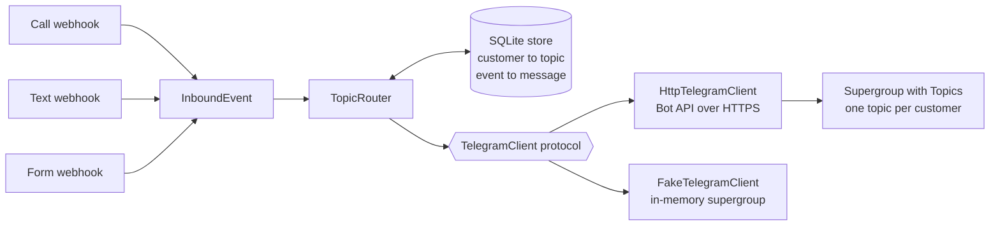
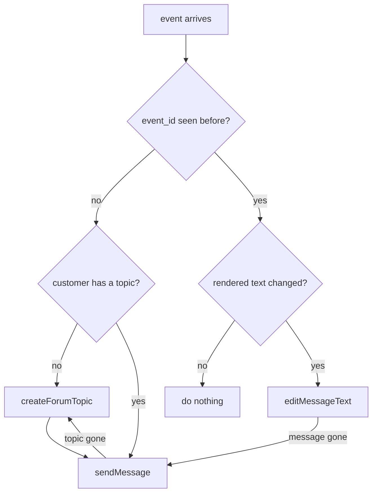

# topic-per-customer-bot

**For a small team that runs its day in one Telegram group.** Calls, texts and web forms from every customer arrive as one flat stream, and each status change ("missed", "voicemail", "booked") adds yet another message. Nobody can see one customer's history without scrolling.

This bot files everything by customer:

- Each customer gets their own forum topic in the group, named `Alex Sample | 555-555-0101`.
- Each call, text or form is one message in that topic. When its status changes, that message is edited in place and keeps a short history line, so the topic stays short.
- A webhook delivered twice changes nothing. A topic or message that someone deleted by hand is put back on the next event.

It is a small Python library (about 740 lines, standard library only, state in one SQLite file) plus an offline demo and 42 tests. **What is proven here runs against an in-memory stand-in for Telegram. The live client is written and unit tested but has never been run against the real Telegram API from this repo.** See [Limitations](#limitations).

## What you will see

`python demo/run_demo.py` needs no token and no network. It replays 12 made-up events from three made-up customers. The first lines of the real output:

```text
== 1. Replay 12 inbound events ==
  call-1001  call  ringing    -> SENT, new topic
  call-1001  call  missed     -> EDITED
  call-1001  call  voicemail  -> EDITED
  call-1001  call  voicemail  -> UNCHANGED
  form-2001  form  new        -> SENT, topic renamed
  text-3001  text  received   -> SENT, new topic
```

and one of the resulting topics, as the team would see it (the text is the raw HTML sent to Telegram, so `>` shows as `&gt;`):

```text
  # Alex Sample | 555-555-0101  (thread 2)
    message 3, edited 2x
      <b>CALL</b> | voicemail
      From: 555-555-0101
      At: 2026-03-02 09:14
      Voicemail: kitchen tap is dripping, please call back.
      History: ringing &gt; missed &gt; voicemail
      Ref: call-1001
```

Twelve events become three topics and five messages. The full captured run is in [`demo/output.txt`](demo/output.txt), and CI fails if the demo stops matching it.

## What it does

- **One topic per customer.** The customer is identified by normalized phone number (or email when there is no phone), so `(555) 555-0101` and `+1 555 555 0101` land in the same topic.
- **Create if missing.** The first event from a new customer creates the topic. If the name arrives later (say, on a web form after a missed call), the topic is renamed.
- **Edit, do not re-send.** Every event carries the source system's `event_id`. A later event with the same id edits the existing message and appends to its status history (`ringing > missed > voicemail`). An identical repeat delivery makes no API call at all.
- **Recovers from manual deletes.** If someone deletes a topic or a message by hand, the next event recreates it instead of failing. This is tested against the fake client only.
- **Telegram behind an interface.** The router talks to a four-method `TelegramClient` protocol. `HttpTelegramClient` is the real one (standard library only). `FakeTelegramClient` is an in-memory supergroup written to raise the errors the Bot API documents for these cases, so tests and the demo need no network and no token.

## Architecture



How one event is handled:



Source layout (about 740 lines):

| File | Role |
| --- | --- |
| `src/topicbot/events.py` | `InboundEvent`, phone and email normalization, customer key |
| `src/topicbot/router.py` | The pattern: find or create topic, send or edit, recover |
| `src/topicbot/store.py` | SQLite map of customer to topic and event to message |
| `src/topicbot/client.py` | `TelegramClient` protocol, HTTP client, fake client, typed errors |
| `src/topicbot/render.py` | Topic titles and message text (HTML parse mode, 4096 char cap) |
| `src/topicbot/__main__.py` | `replay` command, offline by default |
| `src/topicbot/config.py` | Reads the token, chat id and database path from the environment or `.env` |

## Run it

Python 3.10 or newer. There are no runtime dependencies.

```bash
git clone https://github.com/midcityhandyman/topic-per-customer-bot.git
cd topic-per-customer-bot
python demo/run_demo.py
```

To replay your own JSON file of events offline:

```bash
python -m pip install -e .
python -m topicbot replay demo/events.json
```

To point it at a real supergroup, copy `.env.example` to `.env`, fill in a bot token and chat id, and add `--live`. The bot must be an admin with the Manage Topics right in a supergroup that has Topics enabled. This path has not been run by the author against a live group from this repo; without credentials it exits with a clear message and makes no network call.

Using it from your own webhook handler:

```python
from topicbot import HttpTelegramClient, InboundEvent, Store, TopicRouter

router = TopicRouter(HttpTelegramClient(token), Store("topicbot.sqlite3"), chat_id)
router.handle(InboundEvent(event_id="call-1001", kind="call", status="ringing", phone="555-555-0101"))
router.handle(InboundEvent(event_id="call-1001", kind="call", status="missed"))  # edits, does not re-send
```

## Tests

```bash
python -m pip install -r requirements-dev.txt
python -m pytest -q
```

42 tests cover identity normalization, rendering and truncation, the router (create, reuse, edit, duplicate, rename, deleted topic, deleted message, an edit or rename that was applied but not recorded, restart, concurrent threads), the HTTP client's request shapes, error mapping and rate limit retry (through an injected transport, no network), and the command line. None of them touch Telegram. CI runs the same tests on Python 3.10 and 3.12 and checks that the demo still produces `demo/output.txt` byte for byte.

## Demo

`python demo/run_demo.py` replays `demo/events.json` against the fake supergroup, prints what each event did, shows the resulting topics and messages, then deletes a topic to show recovery, and ends with a count of the Bot API calls the router made (4 topic creates, 1 rename, 8 sends, 7 edits for 14 events). All names, numbers and emails in it are synthetic.

## Where this pattern comes from

The author uses the same pattern in private systems for small service businesses whose office and field staff already work in Telegram. None of that code or data is in this repo and nothing here measures it. What is here is a clean, minimal rewrite with synthetic data only, and it should be judged on the code, tests and demo above.

## Limitations

- **Never run against live Telegram.** `HttpTelegramClient` is tested only through a scripted transport that returns canned responses. Its request shapes follow the Bot API documentation. The error strings it matches by substring (`message thread not found`, `TOPIC_DELETED`, `TOPIC_ID_INVALID`, `TOPIC_NOT_MODIFIED`, `message to edit not found`, `MESSAGE_ID_INVALID`, `message is not modified`) have not been observed from the live API in this repo. Confirm them in a test group before relying on the recovery paths.
- **The fake is a model, not Telegram.** `FakeTelegramClient` covers four methods and four failure cases. It does not model permissions, rate limits, the General topic, closed topics or message length checks.
- **No webhook server and no provider integrations.** The repo stops at `router.handle(event)`. Receiving call, text or form webhooks, verifying their signatures and mapping their payloads to `InboundEvent` is left to the caller. The "call, text, form" events in the demo are hand-written JSON.
- **Single process, one lock.** Duplicate topic creation is prevented by one in-process lock that is held across the Telegram call, so events are handled one at a time and a rate limit wait stalls all of them. Two bot processes sharing a database could still both create a topic for a brand new customer.
- **Not crash-atomic.** A crash between a Telegram call and the SQLite write can leave an orphan topic or one duplicate message for that event. An edit or a rename that was applied but not recorded is handled.
- **No retry on network failure.** Timeouts and connection errors from `urllib` are raised to the caller. Only HTTP 429 is retried (wait `retry_after`, up to two retries). There is no queue or global throttle, so a large burst can still fail.
- **Identity is naive.** One phone number is one customer. A customer who calls from a second number, or who uses a phone on one event and only an email on another, gets a second topic. There is no merge.
- **Names are last-write-wins.** Any event that carries a different name renames the topic, so "Alex" on one form and "Alex Sample" on the next causes two renames. Messages already posted keep the name they were rendered with until their own event is next delivered.
- **Arrival order is trusted.** Status updates are applied in the order they arrive; a late `ringing` after `completed` would be appended to the history.
- **Phone handling is North American.** Only a leading `1` on an 11 digit number is stripped. Other country codes are kept as part of the number, and a 7 digit local number does not match its 10 digit form.
- **A recreated topic starts empty.** Earlier messages in a deleted topic are not replayed; each is re-sent only when its event next changes.
- **Plain text only.** Attachments, voicemail audio, photos and replies from staff back to the customer are out of scope.

## License

License: MIT, see the LICENSE file.
