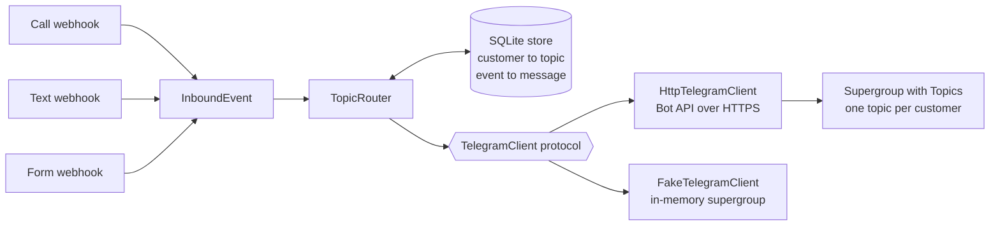
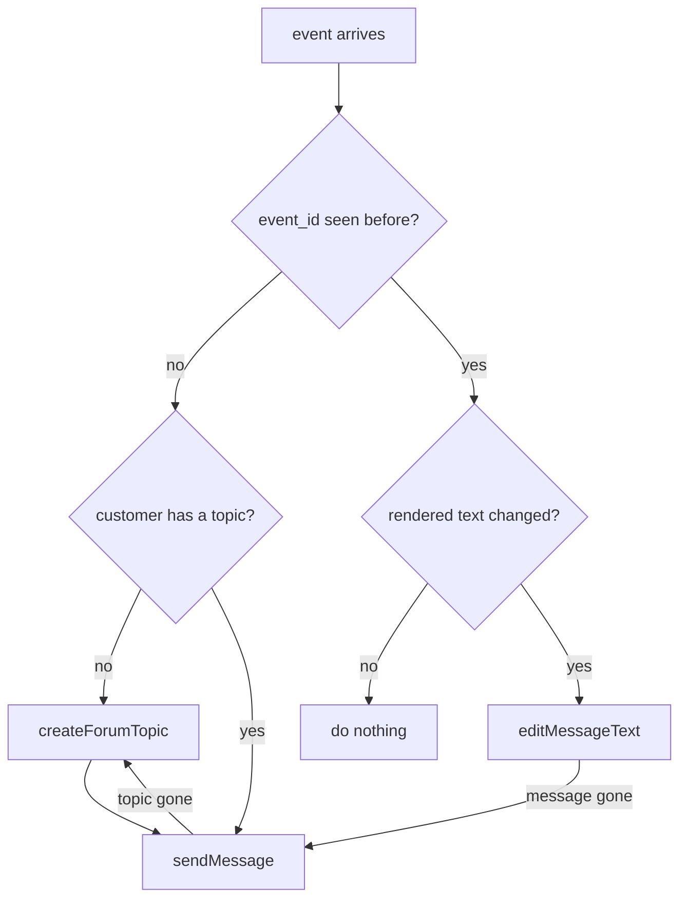

# topic-per-customer-bot

A small team that shares one Telegram group loses track of customers fast: calls, texts and web forms arrive as one flat stream, and every status change adds another message.
This bot gives each customer their own forum topic and keeps one message per event, edited in place as its status changes.

## What it does

- **One topic per customer.** The customer is identified by normalized phone number (or email when there is no phone), so `(555) 555-0101` and `+1 555 555 0101` land in the same topic.
- **Create if missing.** The first event from a new customer creates the topic. If the name arrives later (say, on a web form after a missed call), the topic is renamed.
- **Edit, do not re-send.** Every event carries the source system's `event_id`. A later event with the same id edits the existing message and appends to its status history (`ringing > missed > voicemail`). A duplicate webhook delivery makes no API call at all.
- **Self-healing.** If someone deletes a topic or a message by hand, the next event recreates it instead of failing.
- **Telegram behind an interface.** The router talks to a four-method `TelegramClient` protocol. `HttpTelegramClient` is the real one (standard library only). `FakeTelegramClient` is an in-memory supergroup that raises the same errors the real API does, so tests and the demo need no network and no token.

## Architecture



How one event is handled:



Source layout (about 720 lines):

| File | Role |
| --- | --- |
| `src/topicbot/events.py` | `InboundEvent`, phone and email normalization, customer key |
| `src/topicbot/router.py` | The pattern: find or create topic, send or edit, recover |
| `src/topicbot/store.py` | SQLite map of customer to topic and event to message |
| `src/topicbot/client.py` | `TelegramClient` protocol, HTTP client, fake client, typed errors |
| `src/topicbot/render.py` | Topic titles and message text (HTML parse mode, 4096 char cap) |
| `src/topicbot/__main__.py` | `replay` command, offline by default |

## Run it

Python 3.10 or newer. There are no runtime dependencies.

```bash
git clone <this repo> && cd topic-per-customer-bot
python demo/run_demo.py
```

To replay your own file of events offline: `python -m pip install -e .` then `python -m topicbot replay demo/events.json`.

To point it at a real supergroup, copy `.env.example` to `.env`, fill in a bot token and chat id, and add `--live`. The bot must be an admin with the Manage Topics right in a supergroup that has Topics enabled.

Using it from your own webhook handler:

```python
from topicbot import HttpTelegramClient, InboundEvent, Store, TopicRouter

router = TopicRouter(HttpTelegramClient(token), Store("topicbot.sqlite3"), chat_id)
router.handle(InboundEvent(event_id="call-1001", kind="call", status="ringing", phone="555-555-0101"))
router.handle(InboundEvent(event_id="call-1001", kind="call", status="missed"))  # edits, does not re-send
```

## Tests

```bash
python -m pip install -r requirements-dev.txt
python -m pytest -q
```

39 tests cover identity normalization, rendering and truncation, the router (create, reuse, edit, duplicate, rename, deleted topic, deleted message, restart, concurrency), the HTTP client's request shapes, error mapping and rate limit retry (through an injected transport, no network), and the command line. CI runs the same tests on Python 3.10 and 3.12 and checks that the demo still produces `demo/output.txt` byte for byte.

## Demo

`python demo/run_demo.py` replays `demo/events.json` (12 synthetic events from three made-up customers) against the fake supergroup, prints what each event did, shows the resulting topics and messages, then deletes a topic to show recovery. The captured run is in [`demo/output.txt`](demo/output.txt). The start of it:

```text
== 1. Replay 12 inbound events ==
  call-1001  call  ringing    -> SENT, new topic
  call-1001  call  missed     -> EDITED
  call-1001  call  voicemail  -> EDITED
  call-1001  call  voicemail  -> UNCHANGED
  form-2001  form  new        -> SENT, topic renamed
  text-3001  text  received   -> SENT, new topic
```

Twelve events become three topics and five messages. The message text in the output is the raw HTML sent to Telegram, so `>` shows as `&gt;`.

## Where this pattern runs

This is drawn from systems that run two small service companies day to day, where the office and field staff already live in Telegram and need every call, text and form for a customer in one place without a separate inbox tool. The code here is a clean, minimal rewrite of the pattern with synthetic data only.

## Limitations

- **The live client has not been exercised against Telegram in this repo.** `HttpTelegramClient` is tested through a scripted transport. The error strings it matches (`message thread not found`, `message to edit not found`, `message is not modified`) are matched by substring and should be confirmed against the live API before relying on the recovery paths.
- **No webhook server.** The repo stops at `router.handle(event)`. Receiving provider webhooks, verifying their signatures and mapping their payloads to `InboundEvent` is left to the caller.
- **Single process.** Duplicate topic creation is prevented by one in-process lock. Two bot processes sharing a database could still both create a topic for a brand new customer.
- **Not crash-atomic.** A crash between a Telegram call and the SQLite write can leave an orphan topic or one duplicate message for that event. An edit that was applied but not recorded is handled.
- **Identity is naive.** One phone number is one customer. A customer who calls from a second number, or who uses a phone on one event and only an email on another, gets a second topic. There is no merge.
- **Arrival order is trusted.** Status updates are applied in the order they arrive; a late `ringing` after `completed` would be appended to the history.
- **Phone handling is North American.** Only a leading `1` is stripped. Other country codes are kept as part of the number.
- **Rate limits are handled per call only** (wait `retry_after`, up to two retries). There is no queue or global throttle, so a large burst can still fail.
- **A recreated topic starts empty.** Earlier messages in a deleted topic are not replayed; each is re-sent only when its event next changes.

## License

License: MIT, see the LICENSE file.
